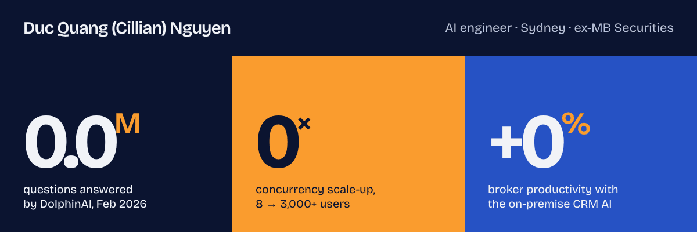
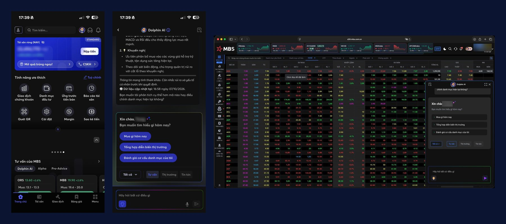
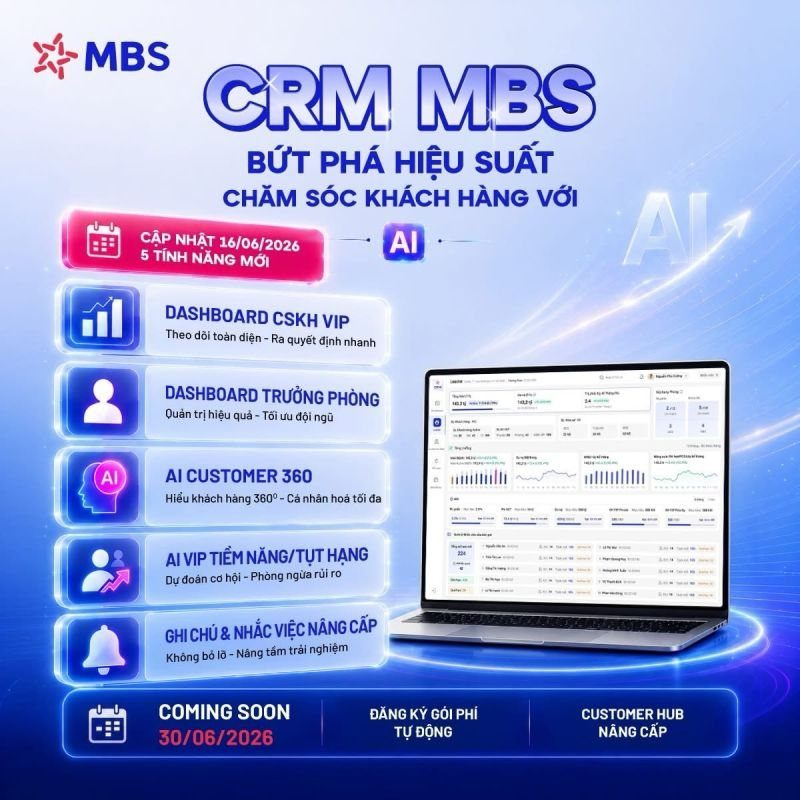
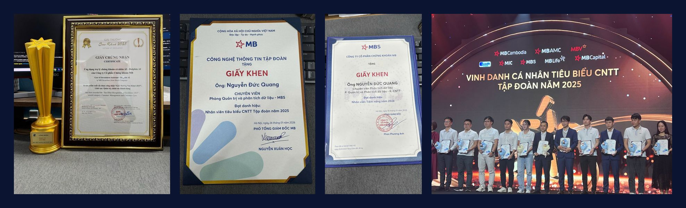

**AI engineer in Sydney with 3 years of experience.** At MB Securities I built DolphinAI and integrated AI into the MBS CRM. Now studying a Master of Computer Science at the University of Sydney.

[**Portfolio**](https://quangcodecode.github.io) · [LinkedIn](https://www.linkedin.com/in/duc-quang-ng) · [Email](mailto:dquangforwork@gmail.com) · [+61 422 475 168](tel:+61422475168) · [Résumé](https://quangcodecode.github.io/assets/Duc_Quang_Nguyen_Resume.pdf)

---

### DolphinAI &nbsp;·&nbsp; [how it's built →](https://github.com/QuangCodecode/dolphinai-case-study)

**2.5M** questions · **50k** users per month · **375×** scale-up · **8×** cheaper · **<15 s** for 99.999% · **Sao Khue 2025**

### CRM AI &nbsp;·&nbsp; [how it's built →](https://github.com/QuangCodecode/crm-ai-platform-case-study)

**+75%** &nbsp;broker productivity

**2–3 weeks** &nbsp;early churn warning

**24,000** VIP clients · **600+** brokers

**6** MCP servers · **36** tools

**On-premise**, built by a 30+ person team, live since June 2026

LangGraph · FastMCP · FastAPI · Langfuse

 

### Awards

**Sao Khue 2025** for DolphinAI · **Outstanding IT Employee, MB Group 2025** (1 of 21 from 15,000) · **High-Potential Employee, MBS 2024**

### Stack

Also: C, SQL, Bash, REST, SSE, Langfuse, Text-Embeddings-Inference, Firestore, dbt, JMeter, n8n, Scrapy, Selenium, Cursor and more.

Master of Computer Science, University of Sydney (2026–28) · Bachelor of Data Science, NEU Hanoi, Distinction · DolphinAI and CRM MBS are products of MB Securities.
